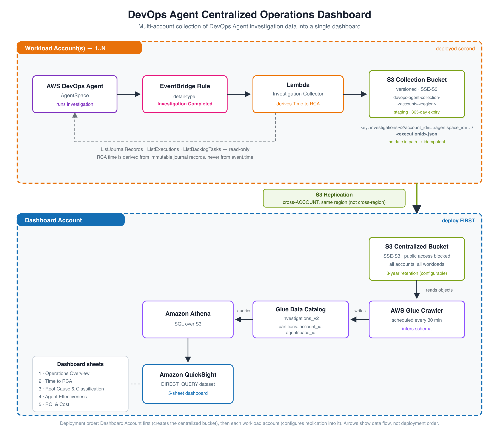

# Guidance for Building a DevOps Agent Centralized Operations Dashboard on AWS

## Table of Contents

1. [Overview](#overview)
2. [Architecture](#architecture)
3. [Cost](#cost)
4. [Prerequisites](#prerequisites)
5. [Deployment](#deployment)
6. [Validation](#validation)
7. [Running the Guidance](#running-the-guidance)
8. [Security](#security)
9. [Next Steps](#next-steps)
10. [Cleanup](#cleanup)
11. [FAQ](#faq)
12. [Revisions](#revisions)
13. [Notices](#notices)

## Overview

This solution provides a centralized operations dashboard for [AWS DevOps Agent](https://docs.aws.amazon.com/devopsagent/latest/userguide/) investigations across multiple AWS accounts. It captures investigation data from EventBridge events, stores structured records in Amazon S3, and surfaces insights through an Amazon QuickSight analysis.

AWS DevOps Agent became [generally available on March 31, 2026](https://aws.amazon.com/about-aws/whats-new/2026/03/aws-devops-agent-generally-available/).

### Key Capabilities

- **Multi-account collection** — Captures investigation completion events from any number of workload accounts
- **Time to RCA** — How long the agent took to reach a root cause, measured from immutable journal records
- **Effectiveness** — Resolution rate and gap rate as deterministic boolean rates, plus p50/p90 duration spread per workload
- **Findings detail** — Per-investigation cascade of symptoms, contributing causes, root cause, gaps, and the resources the agent examined
- **Cost and ROI** — Agent cost per investigation, and engineer hours saved against an adjustable baseline

### Dashboard Sheets

| Sheet | Question it answers |
|-------|---------------------|
| Overview | Is the agent working? Volume, resolution rate, median time to RCA, cost, hours saved, and a resolution-rate-vs-gap-rate trend |
| Effectiveness | Where does it struggle? p50/p90 time to RCA, month-over-month duration, resolution and gap rate per workload, gap texts, resource hotspots |
| Investigations | Which ones need a human? Follow-up queue, full investigation list, click-through to findings and the full root-cause narrative |
| Cost & Recommendations | What does it cost, and what is it recommending? Cost by workload and month, hours saved, and the agent's current recommendations |

All four sheets share one filter bar (date range, workload, account, priority). Selecting a bar or slice cross-filters the rest of the sheet.

## Architecture



### Data Flow

1. **DevOps Agent** completes an investigation in a workload account
2. **Amazon EventBridge** captures the `Investigation Completed` event (source `aws.aidevops`)
3. **AWS Lambda** (investigation collector) fetches journal records through the DevOps Agent API, parses the `investigation_summary` and `utilization` records, and writes one flat JSON object to S3
4. **Amazon S3 Replication** copies that object cross-account into the centralized dashboard bucket, in the same Region
5. **AWS Glue Crawler** (every 30 min) discovers the schema and updates the Glue Data Catalog
6. **Amazon Athena** provides SQL access over the collected records
7. **Amazon QuickSight** queries Athena directly (`DIRECT_QUERY`) and renders the four-sheet analysis

### Accounts

| Account Role | Resources |
|--------------|-----------|
| Workload Account(s) | Investigation collector Lambda, recommendation collector Lambda, EventBridge rule and schedule, S3 collection bucket with replication |
| Dashboard Account | Centralized S3 bucket, Glue database and crawler, Athena workgroup and results bucket, QuickSight data source, datasets, and analysis |

### Regional Scope

This solution deploys into **one Region**, and the collection stack collects the Agent Spaces in the Region it is deployed to. That is usually sufficient, and the reason is worth stating explicitly:

> Per [Supported Regions](https://docs.aws.amazon.com/devopsagent/latest/userguide/about-aws-devops-agent-supported-regions.html), an Agent Space monitors resources in its associated AWS accounts **regardless of which Region those resources are in** — "you do not need to create separate Agent Spaces in each Region where your workloads run." An Agent Space and its investigation data are stored in the Region where the Agent Space was created.

So the Region that matters here is the Region of your **Agent Spaces**, not the Region of the workloads they investigate. If all of your Agent Spaces live in one Region, a single deployment covers everything.

If you have created Agent Spaces in more than one Region, this solution does not yet aggregate them: the S3 key and the record schema carry no Region field, and replication is configured same-Region. Multi-Region aggregation is on the roadmap — see [Next Steps](#next-steps).

## Cost

The dominant costs are QuickSight authoring and DevOps Agent usage itself. Rather than restate a total that ages badly, here are the current published rates and where to verify them.

| Service | What drives the cost | Published rate |
|---------|---------------------|----------------|
| AWS DevOps Agent | Agent time, billed per second | [$0.0083 per agent-second](https://aws.amazon.com/devops-agent/pricing/) for investigations, evaluations, and on-demand SRE tasks |
| Amazon QuickSight | Author licence (Enterprise edition required) | See [QuickSight pricing](https://aws.amazon.com/quicksight/pricing/) — readers are charged per session up to a monthly cap |
| AWS Lambda, Amazon S3, S3 Replication | One invocation and one ~3 KB object per investigation | Cents per month at typical investigation volumes |
| AWS Glue Crawler | Crawler runs (default schedule: every 30 min) | [Glue pricing](https://aws.amazon.com/glue/pricing/) |
| Amazon Athena | Data scanned per query; `DIRECT_QUERY` means each visual refresh scans | [Athena pricing](https://aws.amazon.com/athena/pricing/) |

The collection side of this solution is inexpensive — a year of 100 investigations per month is a few MB of JSON. Use the [AWS Pricing Calculator](https://calculator.aws/) for an estimate against your own volumes.

> **DevOps Agent credits for AWS Support customers.** Customers on paid AWS Support plans receive monthly DevOps Agent credits based on the prior month's AWS Support charge: 100% for Unified Operations, 75% for Enterprise Support, or 30% for Business Support+. Credits expire at the end of each month. See [DevOps Agent pricing](https://aws.amazon.com/devops-agent/pricing/). This affects the `agentCostUsd` figure on the Cost sheet, which is a **list-rate** calculation and does not account for credits.

## Prerequisites

### Required

- One or more AWS accounts with [AWS DevOps Agent](https://docs.aws.amazon.com/devopsagent/latest/userguide/) Agent Spaces
- A separate dashboard account with **Amazon QuickSight Enterprise Edition** enabled
- AWS CLI v2, with credentials for each account
- All accounts in the **same Region** (see [Regional Scope](#regional-scope))

### Strongly Recommended: Tag Your Agent Spaces

Tag every Agent Space with `workload=<workload-name>`:

```bash
aws devops-agent tag-resource \
  --resource-arn arn:aws:aidevops:<region>:<account-id>:agentspace/<agentspace-id> \
  --tags workload=payments \
  --region <region>
```

**This is not a hard requirement — the solution degrades rather than fails.** An untagged Agent Space is still collected in full: duration, root cause, symptoms, effectiveness metrics, and cost all populate normally. Only the workload attribution is lost, and the record lands with `workloadName=unknown`.

What you lose without tags is the grouping dimension most of the dashboard is organized around:

| Sheet | Impact of missing tags |
|---|---|
| Overview | "By workload" collapses into a single `unknown` bar |
| Effectiveness | Cannot compare time to RCA, resolution rate, or gap rate across workloads; resource hotspots lose their grouping level |
| Investigations | Findings pivot loses its top grouping level |
| Cost & Recommendations | Cannot attribute agent spend or recommendations to a workload or team |

The `unknown` value is deliberately visible rather than silent, so a missing tag shows up as a labelled gap in the dashboard instead of an absent row. To fix it: tag the Agent Space, then re-run the backfill script. Because the S3 key is derived from account, Agent Space, and execution ID, the corrected record overwrites the old one in place — no duplicates, no cleanup.

Use one tag value per logical application or service. The value becomes the workload label everywhere in the dashboard, so keep it stable — renaming it later splits that workload's history into two series.

### Permissions

- CloudFormation deployment: `Admin` or equivalent IAM role in each account
- QuickSight: Author permissions in the dashboard account

## Deployment

### Deployment Order Matters

Deploy in this order. The dashboard account **must** be first.

```
Step 1  ──▶  Dashboard Account      (creates the centralized S3 bucket)
Step 2  ──▶  Each Workload Account  (configures replication INTO that bucket)
Step 3  ──▶  Each Workload Account  (backfill existing investigations)
Step 4  ──▶  Dashboard Account      (crawler, then QuickSight datasets + analysis)
```

**Why the order is fixed:** the collection stack configures S3 replication with the dashboard bucket as its destination. Amazon S3 rejects a replication configuration whose destination bucket does not exist, returning `Destination bucket must exist` (HTTP 400, `InvalidRequest`). If you deploy the collection stack first, it fails at the `CollectionBucket` resource and rolls back.

There is no reverse dependency, so the order is safe: the dashboard bucket policy authorizes replication by account ID (`aws:PrincipalAccount`) rather than by naming a replication role ARN. Account IDs are known up front, and no workload-account resource needs to exist when Step 1 runs.

**Why backfill comes before the QuickSight setup:** Step 4 requires the Glue table to exist, and the crawler can only infer a schema once at least one object has landed in the centralized bucket. Running the backfill first means a brand-new install has data on the first pass. If you have no historical investigations, trigger one investigation instead.

> **Note:** This is the opposite of the [Cloud Intelligence Dashboards](https://docs.aws.amazon.com/guidance/latest/cloud-intelligence-dashboards/data-collection-deployment.html) ordering, which deploys read permissions in the Management Account first. CID uses a *pull* model — a central Lambda assumes a role into each source account, so the role must exist first. This solution uses a *push* model (S3 replication), which inverts the dependency.

### Step 1. [Dashboard Account] Deploy the Dashboard Stack

Creates the centralized S3 bucket, Glue database and crawler, Athena workgroup and results bucket, and attaches the required IAM policy to the existing QuickSight service role.

> **Find your QuickSight service role name first.** The default is `aws-quicksight-service-role-v0`:
> ```bash
> aws iam list-roles --query "Roles[?contains(RoleName,'quicksight')].RoleName" --output text
> ```
> If yours differs, pass it as `QuickSightServiceRoleName`.

```bash
DASHBOARD_ACCOUNT_ID=<your-dashboard-account-id>
WORKLOAD_ACCOUNT_IDS=<comma-separated-workload-account-ids>
REGION=<your-region>

aws cloudformation deploy \
  --template-file source/dashboard-account/dashboard-stack.yaml \
  --stack-name devops-agent-dashboard \
  --parameter-overrides \
    WorkloadAccountIds="${WORKLOAD_ACCOUNT_IDS}" \
  --capabilities CAPABILITY_NAMED_IAM \
  --region "${REGION}"
```

List **every** workload account you intend to onboard in `WorkloadAccountIds`. Adding an account later requires updating this stack (see [Adding New Workload Accounts](#adding-new-workload-accounts)).

Wait for `CREATE_COMPLETE` before continuing:

```bash
aws cloudformation wait stack-create-complete \
  --stack-name devops-agent-dashboard --region "${REGION}"
```

### Step 2. [Each Workload Account] Deploy the Collection Module

Creates the collection bucket with replication, both collector Lambdas, the EventBridge rule, and the weekly recommendation schedule.

```bash
DASHBOARD_ACCOUNT_ID=<your-dashboard-account-id>
REGION=<your-region>

# Get the bucket name from the dashboard stack output:
DASHBOARD_BUCKET=$(aws cloudformation describe-stacks \
  --stack-name devops-agent-dashboard --region "${REGION}" \
  --query "Stacks[0].Outputs[?OutputKey=='DashboardBucketName'].OutputValue" --output text)

echo "Dashboard bucket: ${DASHBOARD_BUCKET}"

aws cloudformation deploy \
  --template-file source/collection-module/collection-stack.yaml \
  --stack-name devops-agent-collection \
  --parameter-overrides \
    DashboardAccountId="${DASHBOARD_ACCOUNT_ID}" \
    DashboardBucketName="${DASHBOARD_BUCKET}" \
  --capabilities CAPABILITY_NAMED_IAM \
  --region "${REGION}"
```

Repeat in each workload account. These are independent of each other and can run in parallel.

### Step 3. [Each Workload Account] Backfill Existing Data

EventBridge only fires on events emitted after its rule exists, so investigations that completed before Step 2 are not captured. Load them, and pull the current recommendations rather than waiting for the weekly schedule:

```bash
bash scripts/backfill-historical.sh "${REGION}" --dry-run   # preview, writes nothing
bash scripts/backfill-historical.sh "${REGION}"             # execute
bash scripts/backfill-recommendations.sh "${REGION}"
```

Both are idempotent. See [Backfilling Historical Investigations](#backfilling-historical-investigations) for details and limitations.

### Step 4. [Dashboard Account] Set Up the QuickSight Analysis

Wait 1–2 minutes for replication, run the crawler so the Athena tables exist, then apply the analysis.

```bash
aws glue start-crawler \
  --name "devops-agent-crawler-${DASHBOARD_ACCOUNT_ID}" --region "${REGION}"

# Wait for State to return to READY:
aws glue get-crawler --name "devops-agent-crawler-${DASHBOARD_ACCOUNT_ID}" \
  --query 'Crawler.State' --region "${REGION}"

bash scripts/setup-dashboard.sh "${DASHBOARD_ACCOUNT_ID}" "${REGION}"
```

The script is idempotent — it creates each data source, dataset, and the analysis if absent, and updates them in place if present. Re-run it after any change to `scripts/dashboard-definition.json`.

### Step 5. [Dashboard Account] Publish for Readers

`setup-dashboard.sh` creates an **analysis**, which is only visible to QuickSight authors. Readers need a published **dashboard**:

> QuickSight → open the analysis → **Share** → **Publish dashboard**

Automating this step is tracked in [Next Steps](#next-steps).

## Validation

After deployment, verify the pipeline end to end:

1. **Tag an Agent Space** with `workload=<name>` if not already done
2. **Trigger an investigation** in the DevOps Agent console
3. **Check the collection bucket** in the workload account:
   ```bash
   aws s3 ls "s3://devops-agent-collection-${ACCOUNT_ID}-${REGION}/investigations-v2/" --recursive
   ```
4. **Confirm replication** completed on that object:
   ```bash
   aws s3api head-object \
     --bucket "devops-agent-collection-${ACCOUNT_ID}-${REGION}" \
     --key "investigations-v2/account_id=.../agentspace_id=.../exe-ops1-....json" \
     --query ReplicationStatus
   ```
   `COMPLETED` is success; `PENDING` means wait; `FAILED` is a permissions problem.
5. **Check the dashboard bucket** in the dashboard account:
   ```bash
   aws s3 ls "s3://devops-agent-dashboard-${DASHBOARD_ACCOUNT_ID}/investigations-v2/" --recursive
   ```
6. **Run the Glue crawler** (or wait for the 30-minute schedule)
7. **Query Athena** to confirm the records are readable:
   ```sql
   SELECT workloadname, COUNT(*) AS investigations,
          ROUND(AVG(durationminutes), 1) AS avg_minutes,
          SUM(CASE WHEN resolved THEN 1 ELSE 0 END) AS resolved
   FROM devops_agent_dashboard.investigations_v2
   GROUP BY workloadname;
   ```
8. **Open the analysis** and confirm all four sheets render

## Running the Guidance

### Normal Operation

The solution runs automatically:
- EventBridge triggers the collector on every investigation completion
- S3 replication copies records to the dashboard account within minutes
- The recommendation collector runs weekly (`rate(7 days)`)
- The Glue crawler updates the table schema every 30 minutes
- QuickSight queries Athena at view time (`DIRECT_QUERY`) — there is no SPICE refresh to schedule

### Adding New Workload Accounts

Order matters here too — update the dashboard bucket policy **before** deploying the new collection stack.

1. **[Dashboard Account]** Update the dashboard stack, adding the new account to `WorkloadAccountIds`:
   ```bash
   aws cloudformation deploy \
     --template-file source/dashboard-account/dashboard-stack.yaml \
     --stack-name devops-agent-dashboard \
     --parameter-overrides \
       WorkloadAccountIds="111111111111,222222222222,333333333333" \
     --capabilities CAPABILITY_NAMED_IAM --region "${REGION}"
   ```
2. **[New Account]** Tag Agent Spaces with `workload=<name>`
3. **[New Account]** Deploy the collection stack (Step 2)
4. **[New Account]** Run the backfill scripts (Step 3)

No dashboard or dataset changes are needed. The crawler discovers the new `account_id=` partition automatically, and the existing visuals pick it up.

### Backfilling Historical Investigations

```bash
# In each workload account
bash scripts/backfill-historical.sh "${REGION}" --dry-run   # preview
bash scripts/backfill-historical.sh "${REGION}"             # execute
```

The script walks `ListAgentSpaces` → `ListBacklogTasks` → `ListExecutions`, selects tasks where `taskType=INVESTIGATION` and `status=COMPLETED`, picks the `agentType=ops1` execution for each, and replays it through the collector Lambda as a synthesized EventBridge event. `--dry-run` works before the collection stack is deployed.

**Ordering:** after the backfill completes, wait for S3 replication (~1–2 minutes), then run the Glue crawler in the dashboard account before running `setup-dashboard.sh`.

**Tag corrections:** if you tag or re-tag an Agent Space after initial collection, re-run the backfill in that account. The same S3 keys are overwritten with the corrected `workloadName`. Then run the crawler. No manual deletion or deduplication is needed — the design guarantees idempotency.

## Security

- **Read-only against DevOps Agent.** The collector role holds seven Read/List actions on `aidevops` and no Write actions. It cannot create, modify, or delete Agent Spaces, investigations, recommendations, or mitigations. In particular, `aidevops:UpdateRecommendation` is deliberately never granted — a reporting dashboard must not be able to accept or reject a recommendation on the customer's behalf.
- **No cross-account role assumption.** Data moves by S3 replication (push). The dashboard account never calls into a workload account and holds no workload-account credentials.
- **Least-privilege resource scoping.** DevOps Agent reads are scoped to `arn:aws:aidevops:<region>:<account>:agentspace/*`, except `ListAgentSpaces`, which the [Service Authorization Reference](https://docs.aws.amazon.com/service-authorization/latest/reference/list_devops-agent.html) defines with no resource type. S3 writes are scoped to the local collection bucket.
- **Account-conditioned bucket policy.** The dashboard bucket uses `Principal: "*"` narrowed by `aws:PrincipalAccount` to the explicit workload account list. Only listed accounts can replicate. The condition is not optional — without it the statement would be public.
- **Encryption at rest.** All buckets set SSE-S3 with S3 Bucket Keys explicitly, rather than relying on the account default, so the template cannot be weakened by account-level changes. Replication preserves encryption.
- **Public access blocked.** All buckets set `PublicAccessBlockConfiguration`. The centralized bucket permits bucket policies (required for cross-account replication) but blocks public ACLs and restricts public bucket access.
- **Bounded log retention.** Both collector log groups are declared with a 30-day default rather than left to Lambda's "Never expire".

### What the collected records contain

Investigation records hold investigation **metadata** and agent-generated **narrative text**: symptom titles, the root-cause title and description, contributing causes, investigation gaps, and the labels the agent used for the resources it examined. They do not contain application payloads, log contents, or metric data.

Two things are worth knowing before sharing the dashboard widely:

- **`rootCauseDescription` is free-form agent narrative** and can be long (observed: over 1,500 characters). It describes your infrastructure and what was misconfigured. Treat it with the same sensitivity as an incident write-up.
- **`relatedResources` are the agent's own labels, not ARNs.** Observed values include role-style descriptions such as `Workload Table` and `Processor Function` rather than resource identifiers. They are only meaningful within the workload that produced them, which is why the dashboard groups resource hotspots inside a workload rather than comparing labels across workloads.

Full detail: [permissions model](docs/implementation-guide.md#permissions-model).

## Next Steps

Known gaps and planned work, in rough priority order:

- **Publish the dashboard automatically** — `setup-dashboard.sh` stops at the analysis; readers need a manual publish today (Step 5)
- **Multi-Region aggregation** — required only if you keep Agent Spaces in more than one Region. Needs a `region` field in the collector output and the S3 key, and a decision on replication topology (a dashboard bucket per Region, or cross-Region replication into one bucket)
- **Operational alarms** — a dead-letter queue and failure alarm on the collector Lambda, and an alarm on S3 replication failures. Nothing currently surfaces a silently failing collector
- **Account usage** — the DevOps Agent `GetAccountUsage` API reports monthly agent-hours per account (investigation, evaluation, system-learning, on-demand). Not yet collected
- **Reader access** — share the published dashboard with additional QuickSight readers

## Cleanup

### Remove QuickSight Resources

```bash
bash scripts/teardown-dashboard.sh "${DASHBOARD_ACCOUNT_ID}" "${REGION}"
```

This removes the published dashboard (if any), the analysis, all four datasets, and the data source.

### Remove S3 Data, Then the Stacks

Both buckets have **versioning enabled**, so `aws s3 rm --recursive` is not sufficient — it deletes current object versions but leaves noncurrent versions and delete markers behind, and `aws s3 rb` then fails with `BucketNotEmpty`.

The simplest path is the S3 console's **Empty bucket** action, which purges all versions in one step. From the CLI:

```bash
# Purge all versions and delete markers, then remove the bucket.
# Repeat the delete-objects call if the bucket held more than 1,000 versions.
purge_bucket() {
  BUCKET=$1
  aws s3api delete-objects --bucket "${BUCKET}" --delete "$(
    aws s3api list-object-versions --bucket "${BUCKET}" --output json \
      --query '{Objects: [Versions[].{Key:Key,VersionId:VersionId}, DeleteMarkers[].{Key:Key,VersionId:VersionId}][]}'
  )"
  aws s3 rb "s3://${BUCKET}"
}

# Dashboard account
purge_bucket "devops-agent-dashboard-${DASHBOARD_ACCOUNT_ID}"
purge_bucket "devops-agent-athena-results-${DASHBOARD_ACCOUNT_ID}"

# Each workload account -- note the region suffix in the bucket name
purge_bucket "devops-agent-collection-${ACCOUNT_ID}-${REGION}"
```

**Purge the buckets before deleting the CloudFormation stacks.** The buckets are declared `DeletionPolicy: Delete`, so stack deletion attempts to remove them — and fails with `The bucket you tried to delete is not empty. You must delete all versions in the bucket.` if any object versions remain.

```bash
# Dashboard account
aws cloudformation delete-stack --stack-name devops-agent-dashboard --region "${REGION}"

# Each workload account
aws cloudformation delete-stack --stack-name devops-agent-collection --region "${REGION}"
```

## FAQ

**Q: Which stack do I deploy first?**
A: The **dashboard account** stack, always. The collection stack configures S3 replication pointing at the dashboard bucket, and S3 rejects a replication configuration whose destination does not exist (`Destination bucket must exist`, HTTP 400). Deploying collection first fails and rolls back. Note this is the reverse of the Cloud Intelligence Dashboards order, because CID pulls (assumes a role into source accounts) while this solution pushes (S3 replication).

**Q: Do I need management-account or AWS Organizations access?**
A: No. There are no StackSets, no Organizations trusted access, and no cross-account role assumption. Each stack deploys independently with account-local permissions.

**Q: Does the dashboard account get access into my workload accounts?**
A: No. Data flows one way via S3 replication. The dashboard account never initiates a call into a workload account and holds no credentials for them.

**Q: Do I need to deploy this in every Region where my workloads run?**
A: No. An Agent Space monitors its associated accounts' resources across all Regions ([Supported Regions](https://docs.aws.amazon.com/devopsagent/latest/userguide/about-aws-devops-agent-supported-regions.html)), so the Region that matters is the one your **Agent Spaces** live in. If all your Agent Spaces are in one Region, deploy once. If they span Regions, this solution does not yet aggregate across them — see [Next Steps](#next-steps).

**Q: What DevOps Agent permissions does the collector need?**
A: Seven read/list actions and no write actions — `ListAgentSpaces`, `GetAgentSpace`, `ListJournalRecords`, `ListExecutions`, `ListBacklogTasks`, `ListGoals`, `ListRecommendations`. All except `ListAgentSpaces` are scoped to `agentspace/*` in the local account and Region. The role also holds `s3:PutObject` on the local collection bucket and `tag:GetResources`. See the [permissions model](docs/implementation-guide.md#permissions-model).

**Q: What about investigations from before I deployed this?**
A: Run `scripts/backfill-historical.sh` in each workload account. It discovers past executions through the API and replays them through the collector Lambda. Limited by DevOps Agent journal retention — anything aged out cannot be recovered.

**Q: The stack failed with `InsufficientCapabilitiesException`. Why?**
A: Both stacks create IAM roles with explicit names, which requires `--capabilities CAPABILITY_NAMED_IAM`. `CAPABILITY_IAM` alone is not sufficient.

**Q: Is the time-to-RCA figure stable if an investigation is revisited or mitigated later?**
A: Yes. `durationMinutes` is computed from journal records only — the earliest record to the `investigation_summary` record. Journal records are append-only and their timestamps never change, so the value is fixed once the RCA is produced. Task-level timestamps do drift (observed by up to nine days after a mitigation), which is exactly why they are not used. See [Time to RCA](docs/implementation-guide.md#time-to-rca--stability-guarantee).

**Q: Will re-running the backfill change my existing numbers?**
A: No. Live capture and backfill derive timing identically from the same journal records, so a re-run recomputes the same duration and writes to the same S3 key — it overwrites in place with identical values.

**Q: Why does the backfill filter on task status instead of execution status?**
A: Because a successful execution reports `executionStatus: STOPPED`, not `COMPLETED` — the Execution enum (`FAILED | RUNNING | STOPPED | CANCELED | TIMED_OUT`) contains no success value at all. Task-level `status` is the field that actually says `COMPLETED`.

**Q: What does `resolved` mean?**
A: The collector sets `resolved=true` when the `investigation_summary` contains a finding of type `root_cause`. No such finding means `resolved=false`. It is a property of the agent's output, not a statement about whether the incident was fixed.

**Q: What happens if an Agent Space isn't tagged with `workload`?**
A: The investigation is still captured but `workloadName` shows as `unknown`. Tag the Agent Space, then re-run the backfill script — it overwrites the existing records in place and corrects the value. Run the Glue crawler afterward. No duplicates are created.

**Q: Can I change the 60-minute manual baseline for the hours-saved calculation?**
A: Yes, and you no longer need to edit anything. The Cost & Recommendations sheet has a **baseline slider** (a QuickSight integer parameter, 15–240 minutes) that drives the hours-saved KPI and chart live. The underlying calculated field floors the result at zero, so an investigation slower than the baseline contributes 0 rather than a negative number.

**Q: How much context window utilization is normal?**
A: Utilization varies by investigation complexity. What the dashboard treats as notable is the combination of high utilization **and** at least one compaction event, which is the condition used by the follow-up queue on the Investigations sheet — those are investigations where the agent ran out of room and may have lost context. Adjust the threshold in the `isOutlier` calculated field if your fleet runs consistently higher.

**Q: What's the agent cost calculation?**
A: `agentCostUsd = durationMinutes × 60 × $0.0083`, using the published [per-agent-second rate](https://aws.amazon.com/devops-agent/pricing/). Two caveats: it is a **list-rate** figure that ignores AWS Support plan credits, and it is derived from the investigation's journal-record duration rather than from billing data, so treat it as an estimate rather than an invoice.

**Q: Why don't the recommendations show acceptance rates or history?**
A: The recommendation collector overwrites one object per Agent Space on each poll, so the table always reflects current state and holds no history. Recommendation `status` also churns (`PROPOSED` → `UPDATE_IN_PROGRESS` → `PROPOSED` observed within one hour) and no terminal states have been observed in practice. The only trustworthy freshness signal is `collected_at`, our own poll timestamp, which the sheet displays. See [Recommendations Collection](docs/implementation-guide.md#recommendations-collection).

**Q: What if the Glue crawler finds schema changes?**
A: The crawler is configured with `UpdateBehavior: UPDATE_IN_DATABASE`. New columns are added automatically. Removed columns are logged but not deleted.

## Troubleshooting

### Collection stack fails with `LogGroup already exists`

```
Resource of type 'AWS::Logs::LogGroup' with identifier
'/aws/lambda/devops-agent-investigation-collector' already exists.
```

**Cause:** A previous deployment (even a failed one that rolled back) caused Lambda to auto-create the log group before CloudFormation could. Deleting the stack does not remove it because CloudFormation never owned it.

**Fix:** Delete the orphaned log group, then retry:

```bash
aws logs delete-log-group \
  --log-group-name /aws/lambda/devops-agent-investigation-collector \
  --region "${REGION}"

# If the stack is in ROLLBACK_COMPLETE, delete it first:
aws cloudformation delete-stack --stack-name devops-agent-collection --region "${REGION}"
aws cloudformation wait stack-delete-complete --stack-name devops-agent-collection --region "${REGION}"
```

### Setup script fails with `Table does not exist`

**Cause:** The Glue crawler hasn't run yet, or no data has been collected or backfilled.

**Fix:** Confirm data exists in the centralized bucket, run the crawler, wait for `READY`, then re-run the setup script. If the bucket is empty, run the backfill scripts (Step 3) or trigger an investigation.

### Setup script skips the recommendations dataset

The `recommendations_v1` table only appears after the recommendation collector has run at least once. Run `scripts/backfill-recommendations.sh` in a workload account, then the crawler, then re-run the setup script. The Cost & Recommendations sheet needs this dataset.

### Backfill shows 0 investigations but Agent Spaces exist

1. No `COMPLETED` investigations — the agent hasn't finished any, or all tasks are `SYSTEM_LEARNING` / `EVALUATION` type (filtered out by design)
2. Credentials expired — the script can return empty results from the API rather than an error
3. Journal records aged out — the collector returns "no investigation_summary" and the task is skipped

### Replication not working (objects in the collection bucket but not the centralized one)

1. Verify the dashboard bucket policy allows the workload account:
   ```bash
   aws s3api get-bucket-policy --bucket "devops-agent-dashboard-${DASHBOARD_ACCOUNT_ID}"
   ```
   The workload account must be listed in `WorkloadAccountIds` on the dashboard stack. This is the most common cause after onboarding a new account.
2. Check `ReplicationStatus` on a specific object (see [Validation](#validation) step 4). `FAILED` indicates a permissions problem.

### Dashboard shows "unknown" for workload names

The Agent Space was not tagged with `workload=<name>` when the investigation was collected. Tag it, re-run `scripts/backfill-historical.sh`, then run the crawler.

### The follow-up queue on the Investigations sheet is empty

That is the healthy state, not a fault. The queue filters to investigations that are unresolved, or that combined high context-window utilization with a compaction event. If every investigation reached a root cause without exhausting its context, there is nothing to list.

## Revisions

| Date | Description |
|------|-------------|
| 2026-07-29 | Initial release — five-sheet dashboard with investigation collection and historical backfill |
| 2026-09-14 | Consolidated to a four-sheet analysis (Overview, Effectiveness, Investigations, Cost & Recommendations) with a shared cross-filter bar, click-through investigation drill-down, and a live baseline slider. `setup-dashboard.sh` is now idempotent for every dataset and polls analysis status. Removed the QuickSight Custom Resource from the dashboard stack in favour of the documented script path, and the now-unused `QuickSightUserArn` parameter with it. Documentation corrected against the DevOps Agent GA release. |

## Notices

This solution is provided as-is under the MIT-0 license. See [LICENSE](LICENSE) for details.

AWS DevOps Agent is generally available. Event schemas and API shapes referenced here were verified against the [AWS DevOps Agent User Guide](https://docs.aws.amazon.com/devopsagent/latest/userguide/) and live API responses; verify against current documentation before relying on any specific field.

The agent cost rate used by this solution ($0.0083 per agent-second) reflects published list pricing at the time of writing. Verify current pricing at [AWS DevOps Agent Pricing](https://aws.amazon.com/devops-agent/pricing/), and note that AWS Support plan credits may offset it substantially.
