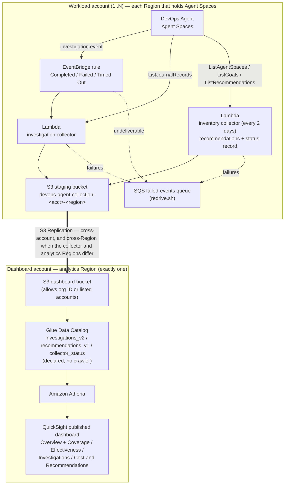

# DevOps Agent Centralized Operations Dashboard on AWS

**See how [AWS DevOps Agent](https://docs.aws.amazon.com/devopsagent/latest/userguide/) is performing across your entire organization — every account and Region — on one Amazon QuickSight dashboard.**

DevOps Agent runs autonomous investigations when something breaks, but each investigation stays inside the single account and Region where it ran. At scale that leaves the questions that matter unanswered: *Is the agent actually helping? How quickly does it reach a root cause? Where does it struggle? What is it costing us, and what is it recommending?*

This guidance answers them. A lightweight **collection stack** in each workload account captures every investigation as one structured record and replicates it to a central **dashboard account**, where Amazon QuickSight presents the fleet-wide picture across four sheets. There are no agents to run, no crawlers, and no data pipeline to operate — records are queryable the moment they replicate.

> **One-way, read-only, serverless.** Collectors hold only read/list permissions against DevOps Agent, data moves in a single direction by S3 replication, and nothing runs between investigations. The dashboard account never calls into a workload account.

AWS DevOps Agent became [generally available on March 31, 2026](https://aws.amazon.com/about-aws/whats-new/2026/03/aws-devops-agent-generally-available/).

## Table of Contents

1. [What you get](#what-you-get)
2. [Does this fit your setup?](#does-this-fit-your-setup)
3. [Architecture](#architecture)
4. [Cost](#cost)
5. [Prerequisites](#prerequisites)
6. [Deployment](#deployment)
7. [Security](#security)
8. [Cleanup](#cleanup)
9. [Operating the solution →](#operating-the-solution) (validation, day-2 ops, troubleshooting, FAQ — in the Implementation Guide)
10. [Revisions](#revisions)
11. [Notices](#notices)

## What you get

**Key capabilities**

- **Multi-account, multi-Region collection** — one collection stack per workload account and Region, deployed by hand or with AWS CloudFormation StackSets across an organization.
- **Time to RCA** — how long the agent took to reach a root cause, measured from immutable journal records.
- **Effectiveness** — resolution rate and gap rate over completed investigations, with p50/p90 duration per workload.
- **Findings detail** — per-investigation symptoms, contributing causes, root cause, gaps, and the resources the agent examined.
- **Cost and ROI** — agent cost per investigation, and engineer hours saved against an adjustable baseline.
- **Coverage** — every deployed collector reports its own health, so you can see which accounts and Regions are collecting, idle, or failing.

**Dashboard sheets**

| Sheet | Question it answers |
|-------|---------------------|
| Overview | Is the agent working, and is collection healthy? Volume, resolution rate, median time to RCA, cost, hours saved, trend, and the Coverage table of every collector |
| Effectiveness | Where does it struggle? p50/p90 time to RCA, month-over-month duration, resolution and gap rate per workload, gap texts, resource hotspots |
| Investigations | Which ones need a human? Follow-up queue, full investigation list, click-through to findings and the full root-cause narrative |
| Cost & Recommendations | What does it cost, and what is it recommending? Cost by workload and month, hours saved, and the agent's current recommendations |

All four sheets share one filter bar — date range, workload, account, Region, and priority — and selecting a bar or slice cross-filters the rest of the sheet. Investigation metrics count **completed** investigations; failed and timed-out ones are recorded too and counted per collector on the Coverage table.

## Does this fit your setup?

> **This guidance assumes one or more Agent Spaces per workload account, created in that account and monitoring that account's own workloads.** It does **not** support a central model in which one Agent Space in a shared account monitors many other accounts — there, every investigation records under the shared account, so the account and Region views would attribute everything to it.

Two supported shapes, as long as each Agent Space monitors its own account:

| Shape | What it looks like | How to deploy |
|---|---|---|
| **Distributed** | Each workload account runs its own Agent Space(s) | Organization path (StackSet across OUs × Regions), or standalone per account — [Deployment](#deployment) Step 3a or 3b |
| **Consolidated** | One account holds many Agent Spaces, one per workload or team, each monitoring that account's own workloads | Standalone path in that one account, once per Region that holds Agent Spaces — [Deployment](#deployment) Step 3b |

Every Agent Space must carry a `workload` tag or a meaningful name — the dashboard separates teams and workloads by that label. In the **consolidated** shape it is effectively required, since account and Region are identical for every Agent Space.

## Architecture



Collection stacks are deployed by a CloudFormation StackSet (organization path) or per account (standalone). Arrows show data flow, not deployment order.

### Data flow

1. **AWS DevOps Agent** finishes an investigation in a workload account: completed, failed, or timed out.
2. **Amazon EventBridge** matches the event (source `aws.aidevops`) and invokes the investigation collector.
3. **AWS Lambda** (investigation collector) reads the investigation's journal records through the DevOps Agent API and writes one JSON record to the account's staging bucket.
4. **AWS Lambda** (inventory collector), every 2 days, lists the Agent Spaces, writes their current recommendations, and writes a status record for the collector.
5. **Amazon S3 Replication** copies those objects into the centralized dashboard bucket — cross-account, and cross-Region when the collector and the dashboard are in different Regions.
6. **AWS Glue Data Catalog** holds fixed table definitions, deployed with the dashboard stack. **Amazon Athena** queries the records in place.
7. **Amazon QuickSight** queries Athena at view time (`DIRECT_QUERY`) and renders the dashboard.

A record is queryable as soon as it replicates. There is no crawler or refresh schedule in the path.

### Components

| Where | Deployed by | Contents |
|-------|-------------|----------|
| Dashboard account, analytics Region (once) | `source/dashboard/dashboard-stack.yaml` | Dashboard bucket, Glue database and three tables, Athena workgroup and results bucket, QuickSight service-role policy |
| Dashboard account, analytics Region (once) | `scripts/setup-dashboard.sh` | QuickSight data source, five datasets, analysis, and published dashboard |
| Each workload account × Region | `source/collection/collection-stack.yaml` | Staging bucket with replication, investigation collector, inventory collector, EventBridge rule and schedule, failed-events queue |
| Workload accounts with earlier history (once) | `scripts/backfill.sh` | Loads investigations that finished before the collection stack existed |

### Regional scope

Two kinds of Region matter, and they are independent:

| Region | What lives there | How many |
|---|---|---|
| **Analytics Region** | The dashboard stack and QuickSight | Exactly one |
| **Agent Space Regions** | The collection stack, alongside the Agent Spaces it reads | One or more per workload account |

An Agent Space is a Regional resource, and so is its collector: `ListAgentSpaces` returns only the Agent Spaces in the Region it is called in, and the EventBridge rule only sees events in its own Region. So the collection stack is deployed **per workload account, per Region that holds Agent Spaces**. You do **not** need a collector in every Region your workloads run in — an Agent Space monitors its accounts' resources in every Region regardless. Every record carries the **Region of the Agent Space** that ran the investigation, not the Region of the investigated resources.

Cross-Region replication adds a small [inter-Region data transfer](https://aws.amazon.com/s3/pricing/) charge (~3 KB per investigation); collectors in the analytics Region replicate for free. Any [opt-in Region](https://docs.aws.amazon.com/AmazonS3/latest/userguide/replication-requirements.html) must be enabled in both the workload and dashboard accounts. See the Implementation Guide's [Multi-Region Design](docs/implementation-guide.md#multi-region-design) for the full model.

### Deployment options

| | Organization path (recommended) | Standalone path |
|---|---|---|
| Collection stacks deployed by | One CloudFormation StackSet, targeting OUs or the whole organization × a list of Regions | `aws cloudformation deploy`, once per account × Region |
| New accounts | Receive the collection stack automatically (StackSets auto-deployment) | Deploy by hand |
| Dashboard bucket authorizes | Your organization ID (`aws:PrincipalOrgID`) — no change when accounts are added | An explicit account list — update the dashboard stack for each new account |
| Fits | Organizations of any size, especially large or growing ones | A few accounts, or no AWS Organizations |

Both paths deploy the same two templates, following the pattern used by other AWS multi-account dashboards such as [HEIDI](https://github.com/aws-solutions-library-samples/aws-health-events-insight).

**You choose the footprint.** The StackSet deploys only to the account:Region pairs you select — target OUs or accounts × your chosen list of Regions. Scope it to the Regions your Agent Spaces actually use. You *can* include Regions with no Agent Spaces yet (each gets a near-free idle collector that reports `NO_AGENT_SPACES` and starts collecting the day a team creates an Agent Space there), but that breadth is optional, not the default.

## Cost

The main costs are QuickSight authoring and DevOps Agent usage itself. Current published rates:

| Service | What drives the cost | Published rate |
|---------|---------------------|----------------|
| AWS DevOps Agent | Agent time, billed per second | [$0.0083 per agent-second](https://aws.amazon.com/devops-agent/pricing/) for investigations, evaluations, and on-demand SRE tasks |
| Amazon QuickSight | Author licence (Enterprise edition required); reader sessions | See [QuickSight pricing](https://aws.amazon.com/quicksight/pricing/) |
| AWS Lambda | One invocation per investigation, and one inventory run every 2 days per collector | Cents per month at typical volumes |
| Amazon S3 and S3 Replication | One ~3 KB object per investigation, plus one status and one recommendations object per collector | Cents per month. Cross-Region replication adds [inter-Region data transfer](https://aws.amazon.com/s3/pricing/) |
| Amazon SQS | The failed-events queue; normally empty | Negligible |
| Amazon Athena | Data scanned per query; `DIRECT_QUERY` means each visual refresh scans | [Athena pricing](https://aws.amazon.com/athena/pricing/) |

An idle collector (an account or Region without Agent Spaces) costs one short Lambda run every 2 days and two tiny S3 objects. Use the [AWS Pricing Calculator](https://calculator.aws/) for an estimate against your own volumes.

> **DevOps Agent credits for AWS Support customers.** Customers on paid AWS Support plans receive monthly DevOps Agent credits based on the prior month's AWS Support charge: 100% for Unified Operations, 75% for Enterprise Support, or 30% for Business Support+. Credits expire at the end of each month. See [DevOps Agent pricing](https://aws.amazon.com/devops-agent/pricing/). The dashboard's `agentCostUsd` is a **list-rate** calculation and does not account for credits.

## Prerequisites

- AWS accounts with [AWS DevOps Agent](https://docs.aws.amazon.com/devopsagent/latest/userguide/) Agent Spaces, in one or more Regions, following the [supported model](#does-this-fit-your-setup).
- A **dedicated dashboard account** — not your AWS Organizations management account — with **Amazon QuickSight Enterprise edition** enabled in the Region you choose as the analytics Region.
- AWS CLI v2 and credentials for the accounts you deploy to; run the scripts from any local terminal.
- Organization path only: [trusted access for StackSets with AWS Organizations](https://docs.aws.amazon.com/AWSCloudFormation/latest/UserGuide/stacksets-orgs-activate-trusted-access.html) activated, and access to the management account or a [StackSets delegated administrator](https://docs.aws.amazon.com/AWSCloudFormation/latest/UserGuide/stacksets-orgs-delegated-admin.html).
- Any opt-in Region that holds Agent Spaces enabled in both that workload account and the dashboard account.

**Recommended — tag your Agent Spaces** with `workload=<workload-name>`:

```bash
aws devops-agent tag-resource \
  --resource-arn arn:aws:aidevops:<region>:<account-id>:agentspace/<agentspace-id> \
  --tags workload=payments \
  --region <region>
```

The workload label on every record resolves in order: the `workload` tag → the Agent Space's **name** → `unknown` (only if the collector could not read the Agent Space). An untagged Agent Space still charts under its name, but a tag is the deliberate, stable way to set it — several Agent Spaces in one application can share a tag value and chart as one workload. Keep tag values stable; changing one later splits that workload's history. To relabel, re-tag and run `scripts/backfill.sh` for that account and Region.

## Deployment

Deploy in this order — **the dashboard stack must be first**, because S3 rejects a replication configuration whose destination bucket does not exist:

```
Step 1  Dashboard account, analytics Region   dashboard-stack.yaml
Step 2  Dashboard account, analytics Region   setup-dashboard.sh  (works with no data yet)
Step 3  Workload accounts × Regions           collection-stack.yaml  (StackSet or per account)
Step 4  Accounts with earlier history         backfill.sh  (once)
```

### Step 1. [Dashboard account] Deploy the dashboard stack

Creates the dashboard bucket, the Glue database and tables, the Athena workgroup and results bucket, and attaches a policy to the existing QuickSight service role.

> Find your QuickSight service role name first (default `aws-quicksight-service-role-v0`):
> ```bash
> aws iam list-roles --query "Roles[?contains(RoleName,'quicksight')].RoleName" --output text
> ```

Choose who may replicate into the dashboard bucket — your organization ID (organization path; accounts added later need no change) or an explicit account list (standalone path). You can pass both; the stack rejects a deployment that sets neither.

```bash
ANALYTICS_REGION=<analytics-region>

aws cloudformation deploy \
  --template-file source/dashboard/dashboard-stack.yaml \
  --stack-name devops-agent-dashboard \
  --parameter-overrides OrganizationIds=<o-xxxxxxxxxx> \
  --capabilities CAPABILITY_NAMED_IAM \
  --region "${ANALYTICS_REGION}"
# Standalone path: --parameter-overrides WorkloadAccountIds=111111111111,222222222222
```

The dashboard bucket is named `devops-agent-dashboard-<dashboard-account-id>`. Every collection stack needs that name and the dashboard account ID.

### Step 2. [Dashboard account] Create the QuickSight dashboard

```bash
bash scripts/setup-dashboard.sh <dashboard-account-id> "${ANALYTICS_REGION}"
```

Creates the Athena data source, five datasets, the analysis, and a **published dashboard**. It works before any data exists, so the dashboard renders empty and fills in as collectors start writing. Idempotent — re-run it after any change to `scripts/dashboard-definition.json`.

> **QuickSight S3 access (required).** The dashboard stack grants QuickSight's service role access to the buckets in IAM, but QuickSight also enforces its own bucket allow-list. If the visuals show a database/SQL error, open **Manage QuickSight → Security & permissions → QuickSight access to AWS services → S3** and enable both `devops-agent-dashboard-<dashboard-account-id>` (read) and `devops-agent-athena-results-<dashboard-account-id>` (read and write).

Share the dashboard with readers from QuickSight: open the dashboard → **Share** → **Share dashboard**.

### Step 3a. [Organization path] Deploy the collection StackSet

Run from the management account, or from a StackSets delegated administrator account by adding `--call-as DELEGATED_ADMIN`. The StackSet lives in the Region you run these commands in; its stack instances go to the Regions you list.

```bash
DASHBOARD_ACCOUNT_ID=<dashboard-account-id>

aws cloudformation create-stack-set \
  --stack-set-name devops-agent-collection \
  --template-body file://source/collection/collection-stack.yaml \
  --parameters ParameterKey=DashboardAccountId,ParameterValue="${DASHBOARD_ACCOUNT_ID}" \
               ParameterKey=DashboardBucketName,ParameterValue="devops-agent-dashboard-${DASHBOARD_ACCOUNT_ID}" \
  --capabilities CAPABILITY_NAMED_IAM \
  --permission-model SERVICE_MANAGED \
  --auto-deployment Enabled=true,RetainStacksOnAccountRemoval=true \
  --managed-execution Active=true

aws cloudformation create-stack-instances \
  --stack-set-name devops-agent-collection \
  --deployment-targets OrganizationalUnitIds=<ou-id-1>,<ou-id-2> \
  --regions <region-1> <region-2> \
  --operation-preferences RegionConcurrencyType=PARALLEL,MaxConcurrentPercentage=25,FailureTolerancePercentage=10
```

Key settings: **auto-deployment** adds the stack to accounts that join a targeted OU and **retains** it on removal (required — the versioned staging bucket cannot be deleted automatically); **managed execution** allows concurrent non-conflicting operations; **failure tolerance** lets the rollout continue when a few instances fail (e.g. an account that has not enabled an opt-in Region). Note StackSets never deploy to the management account (use Step 3b there), and auto-deployment ignores account filters. Full detail, including recovery of failed instances: [Deployment at Scale](docs/implementation-guide.md#deployment-at-scale) and [Failures and Recovery](docs/implementation-guide.md#failures-and-recovery).

### Step 3b. [Standalone path] Deploy the collection stack per account and Region

Run with workload-account credentials, once per Region that holds Agent Spaces:

```bash
DASHBOARD_ACCOUNT_ID=<dashboard-account-id>

for REGION in <region-1> <region-2>; do
  aws cloudformation deploy \
    --template-file source/collection/collection-stack.yaml \
    --stack-name devops-agent-collection \
    --parameter-overrides \
      DashboardAccountId="${DASHBOARD_ACCOUNT_ID}" \
      DashboardBucketName="devops-agent-dashboard-${DASHBOARD_ACCOUNT_ID}" \
    --capabilities CAPABILITY_NAMED_IAM \
    --region "${REGION}"
done
```

Use **one path per account**. A standalone stack and a StackSet instance in the same account and Region collide on fixed resource names; to move an account to the organization path, delete its standalone stack first (see [Cleanup](#cleanup)).

### Step 4. [Accounts with earlier history] Backfill once

EventBridge only delivers events that happen after the rule exists. For accounts that **already had** DevOps Agent investigations when you deployed the collection stack, load that history once, with the account's credentials:

```bash
bash scripts/backfill.sh <region-1>,<region-2> --dry-run   # list what would be loaded; writes nothing
bash scripts/backfill.sh <region-1>,<region-2>             # load it
```

It replays each finished investigation through the collector, then refreshes the account's recommendations and Coverage row. Accounts that adopt DevOps Agent *after* the stack is deployed are captured live and need no backfill. History is limited to what DevOps Agent still retains in its journal; aged-out investigations are reported `SKIP`.

**After deploying, validate the pipeline end to end** — see [Validation](docs/implementation-guide.md#validation) in the Implementation Guide.

## Security

- **Read-only against DevOps Agent.** Collector roles hold only Read/List `aidevops` actions — they cannot create, modify, or delete Agent Spaces, investigations, or recommendations. `aidevops:UpdateRecommendation` is deliberately never granted.
- **One role per function, scoped to the account and Region.** Each collector writes only under its own prefix in its own staging bucket; DevOps Agent reads are scoped to `agentspace/*`, except `ListAgentSpaces`, which has no resource type.
- **No cross-account role assumption.** Data moves one way, by S3 replication. The dashboard account never calls into a workload account and holds no workload-account credentials.
- **Non-public buckets.** The dashboard bucket policy allows replication only from your organization (`aws:PrincipalOrgID`) or listed accounts; all four Block Public Access settings are on for every bucket.
- **Encryption and bounded retention.** SSE-S3 with Bucket Keys on all buckets, SQS-managed encryption on the queue, TLS enforced by policy; log, staging, dashboard, Athena-results, and queue retentions are all capped.

Investigation records hold investigation **metadata** and agent-written **narrative text** (symptom titles, root-cause title/description, gaps, resource labels) — not application payloads, log contents, or metric data. Note `rootCauseDescription` is free-form agent narrative describing your infrastructure (treat it like an incident write-up), and **every dashboard reader sees every account's data** (reader-level row security is not configured). Full detail: [permissions model](docs/implementation-guide.md#permissions-model) and [what the records contain](docs/implementation-guide.md#what-the-collected-records-contain).

## Cleanup

QuickSight objects are not in a stack (delete them first), and every bucket is versioned, so each must be emptied before its stack will delete. Full commands — including the `purge_bucket` helper and the StackSet instance teardown — are in the Implementation Guide: **[Cleanup](docs/implementation-guide.md#cleanup)**.

Order: (1) delete the QuickSight dashboard → analysis → datasets → data source; (2) empty every versioned bucket (never with `aws s3 rm` — it writes delete markers that replicate); (3) delete the collection stacks / StackSet instances; (4) empty and delete the dashboard and Athena-results buckets, then the dashboard stack.

## Operating the solution

Day-2 material lives in the **[Implementation Guide](docs/implementation-guide.md)** to keep this page focused on understanding and deploying the solution:

- **[Validation](docs/implementation-guide.md#validation)** — confirm Coverage, live capture, replication, Athena, and the no-double-counting check.
- **[Running the Guidance](docs/implementation-guide.md#running-the-guidance)** — normal operation, what happens when things change, and the one-record-per-investigation invariant.
- **[Failures and Recovery](docs/implementation-guide.md#failures-and-recovery)** — every failure the Coverage table surfaces, and how to fix it.
- **[Troubleshooting](docs/implementation-guide.md#troubleshooting)** and **[FAQ](docs/implementation-guide.md#faq)**.
- **Internals** — [permissions model](docs/implementation-guide.md#permissions-model), [data model](docs/implementation-guide.md#data-model), [collection](docs/implementation-guide.md#investigation-collection), [multi-Region design](docs/implementation-guide.md#multi-region-design), and [QuickSight datasets](docs/implementation-guide.md#quicksight-datasets).

## Revisions

| Date | Description |
|------|-------------|
| 2026-09-28 | Version 1.0.0. Multi-account, multi-Region collection with organization (StackSets) and standalone deployment paths; Coverage table; failed and timed-out investigations recorded; failed-events queue with redrive; fixed Glue tables, so the dashboard deploys before any data exists; published dashboard created by the setup script. |

## Notices

This solution is provided as-is under the MIT-0 license. See [LICENSE](LICENSE) for details.

Event schemas and API shapes referenced here were verified against the [AWS DevOps Agent User Guide](https://docs.aws.amazon.com/devopsagent/latest/userguide/) and live API responses; verify against current documentation before relying on any specific field.

The agent cost rate used by this solution ($0.0083 per agent-second) reflects published list pricing at the time of writing. Verify current pricing at [AWS DevOps Agent Pricing](https://aws.amazon.com/devops-agent/pricing/), and note that AWS Support plan credits may offset it substantially.
